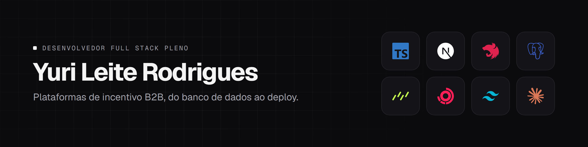

Gosto de sistema que aguenta o dia da apuração: a base nova do cliente chega, o ranking recalcula e quem está usando o portal nem percebe.

Sou desenvolvedor full stack pleno na [Agência Molla](https://www.linkedin.com/company/15158549/), onde construo plataformas de incentivo B2B do banco de dados ao deploy, com Next.js, NestJS e PostgreSQL. Voltei para a Molla em março de 2026 e fui promovido a pleno quatro meses depois.

[Portfólio](https://yurilrodrigues.github.io/portfolio-v3/) · [Currículo (PDF)](https://yurilrodrigues.github.io/portfolio-v3/curriculo.pdf) · [LinkedIn](https://www.linkedin.com/in/yuri-leite-rodrigues/) · [E-mail](mailto:rodriguesyuri769@gmail.com)

### O que construí em 2026

Projetos da Molla, em repositórios privados:

- **Hub Azul**: transformei o portal de uma campanha no login único de todas as campanhas da Azul, com SSO em OpenID Connect, carteira de moedas, resgates e treinamentos.
- **Agente Tá On**: portal de incentivo para cerca de 21 mil agentes de viagem, com ranking recalculado a cada 30 minutos e carga de dados que não deixa o portal vazio.
- **Template de incentivo**: levei o template da agência para um monorepo em Turborepo, com API, portal, dashboard e um pacote de UI compartilhado. Com as regras do cliente definidas, um programa novo vai ao ar em cerca de 10 dias.
- **Nova landing page da Molla**: em português, inglês e espanhol, com a seção de DNA em que Trade, Marketing e Vendas se trançam numa hélice conforme a rolagem.
- **Documentação técnica** de sete projetos gerada a partir do código: regras de negócio x banco de dados e todas as rotinas automáticas.

### Como eu trabalho

- Regra de negócio e modelo de dados antes da tela.
- Projeto novo começa de um template com padrões escritos, não do zero.
- Uso Claude Code todo dia, com skills e documentação que fazem os agentes seguirem o padrão do projeto. O agente acelera; a revisão e a decisão continuam comigo.
- Teste onde a regra mexe com ponto e prêmio.

### Open source

| Repositório | O que é |
| --- | --- |
| [nestjs-drizzle-clean-architecture](https://github.com/YuriLRodrigues/nestjs-drizzle-clean-architecture) | API NestJS + Drizzle com Clean Architecture, camadas garantidas por lint e testes unitários, de integração e E2E contra Postgres. |
| [nextjs-shadcn-orval-template](https://github.com/YuriLRodrigues/nextjs-shadcn-orval-template) | Front Next.js 16 com shadcn/ui, Server Actions e client da API gerado do OpenAPI. Funciona em par com o template acima. |
| [lp-fullstack-template](https://github.com/YuriLRodrigues/lp-fullstack-template) | Landing page que apresenta os dois templates, em português e inglês. |
| [portfolio-v3](https://github.com/YuriLRodrigues/portfolio-v3) | Este portfólio: Next.js 16 estático no GitHub Pages, português e inglês, layout com container queries. |

Os templates vêm com `CLAUDE.md` e skills do Claude Code que conhecem os padrões do projeto.

### Projetos pessoais

- [Workout Tracker](https://github.com/YuriLRodrigues/workout-tracker): treinos, cargas e evolução, com API em NestJS ([api](https://github.com/YuriLRodrigues/workout-tracker-api)) e front em Next.js.
- [AutoCars](https://github.com/YuriLRodrigues/autocars-frontend): classificados de veículos com painel do vendedor ([api](https://github.com/YuriLRodrigues/autocars-backend)).
- [Fincheck](https://github.com/YuriLRodrigues/fincheck): finanças pessoais com NestJS, Prisma e React.

### Stack

TypeScript · Next.js · React · NestJS · Node.js · PostgreSQL · Drizzle · Redis · BullMQ · Turborepo · Tailwind CSS · shadcn/ui · TanStack Query · Vitest · Playwright · Docker · AWS · Claude Code
