<a href="https://yurilrodrigues.github.io/portfolio-v3/"><picture><source media="(prefers-color-scheme: dark)" srcset="./assets/banner.png" />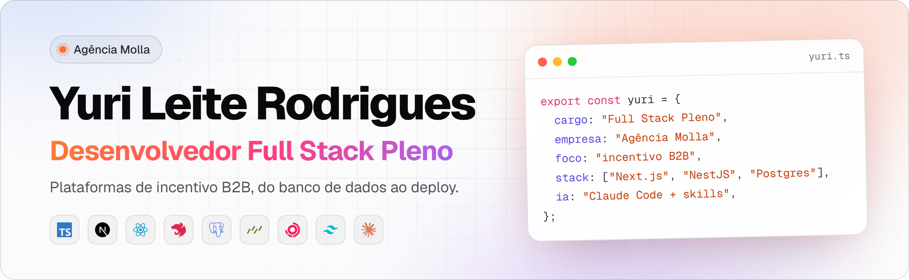</picture></a>

  
  
  
  

Gosto de sistema que aguenta o dia da apuração: a base nova do cliente chega, o ranking recalcula e quem está usando o portal nem percebe.

Sou desenvolvedor full stack pleno na [Agência Molla](https://www.linkedin.com/company/15158549/), onde construo plataformas de incentivo B2B do banco de dados ao deploy, com Next.js, NestJS e PostgreSQL. Voltei para a Molla em março de 2026 e fui promovido a pleno quatro meses depois.

### O que construí em 2026

<picture><source media="(prefers-color-scheme: dark)" srcset="./assets/numeros-2026.png" />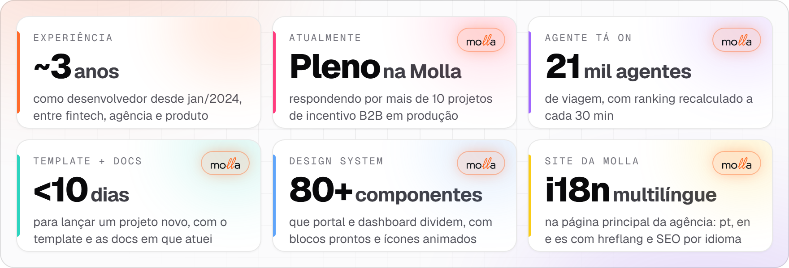</picture>

Projetos da Molla, em repositórios privados:

- **Hub Azul**: o portal de uma campanha virou o login único de todas as campanhas da Azul, com SSO em OpenID Connect, carteira de moedas, resgates e treinamentos.
- **Agente Tá On**: portal de incentivo para cerca de 21 mil agentes de viagem. Cada base nova entra num schema separado e só substitui a anterior quando está pronta, então o portal nunca fica vazio.
- **Template de incentivo**: levei o template da agência para um monorepo em Turborepo, com API, portal, dashboard e um pacote de UI compartilhado. Com ele e a documentação em que atuei, um projeto novo é lançado em menos de 10 dias.
- **Novo site da Molla**: a página principal da agência e a vitrine de como ela se apresenta às marcas. Substituiu o site antigo em ASP.NET com redirects 301, é multilíngue (pt, en, es) com hreflang e JSON-LD por idioma, e tem logo 3D em Three.js, animações em GSAP e a seção do DNA, em que Trade, Marketing e Vendas se trançam numa hélice conforme a rolagem. Antes de fechar o visual, montei uma página interna com as variações de cada seção ao vivo para a Molla escolher a direção.
- **Documentação técnica** de sete projetos gerada a partir do código: regras de negócio x banco de dados e todas as rotinas automáticas.

### Open source e produtos

  <a href="https://github.com/YuriLRodrigues/turbo-repo-template"><picture><source media="(prefers-color-scheme: dark)" srcset="./assets/card-turbo-repo-template.png" />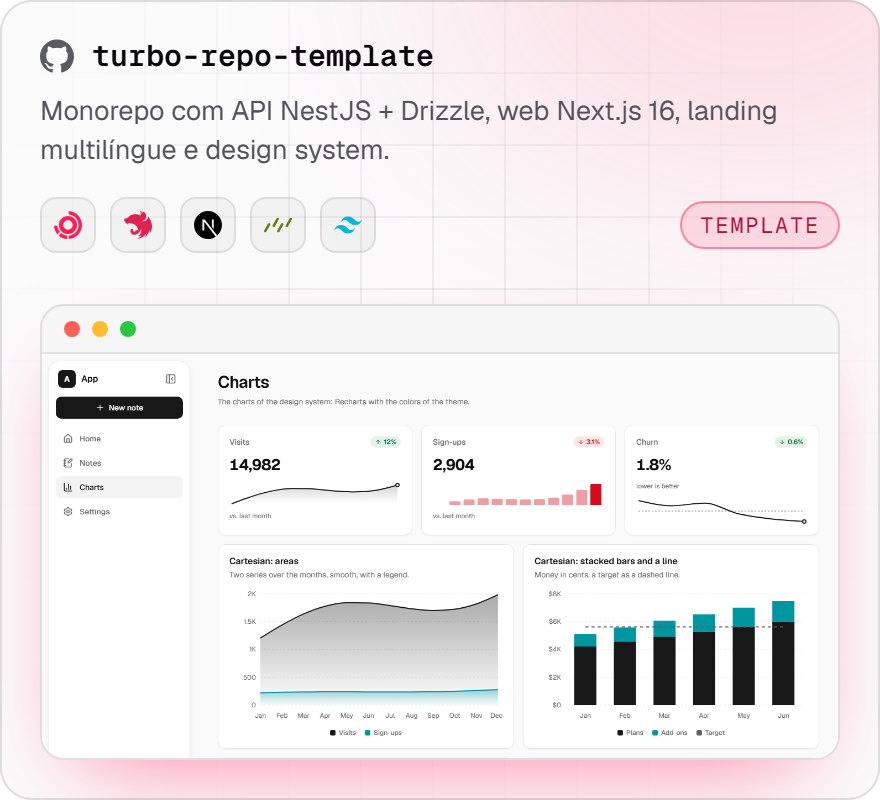</picture></a>
  <a href="https://github.com/YuriLRodrigues/nestjs-drizzle-clean-architecture"><picture><source media="(prefers-color-scheme: dark)" srcset="./assets/card-nestjs-drizzle.png" />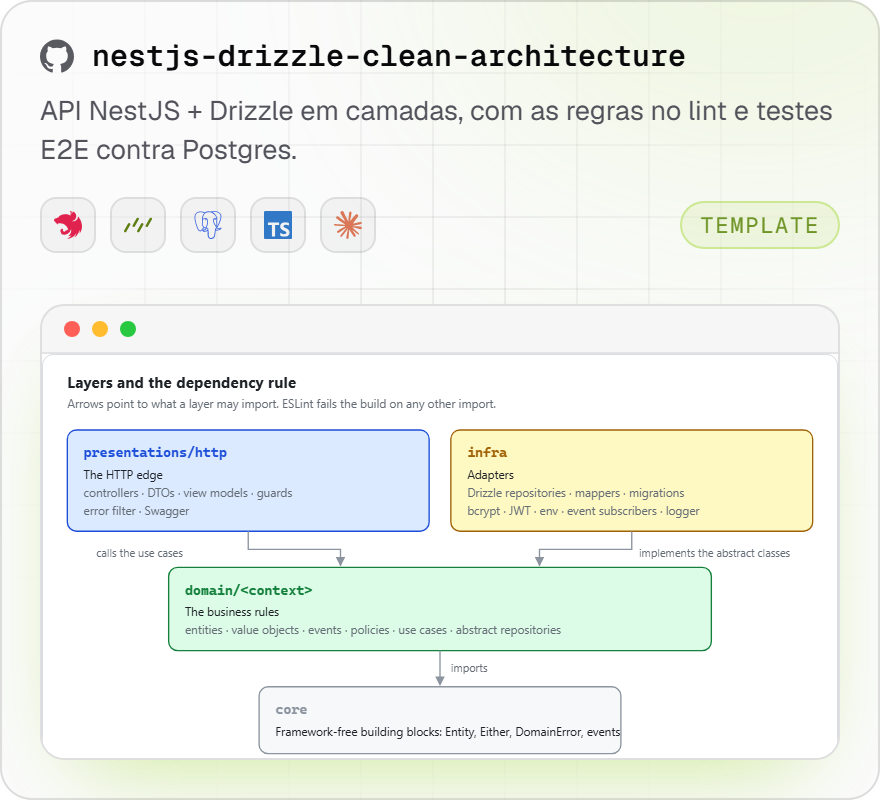</picture></a>
  <a href="https://github.com/YuriLRodrigues/nextjs-shadcn-orval-template"><picture><source media="(prefers-color-scheme: dark)" srcset="./assets/card-nextjs-shadcn-orval.png" />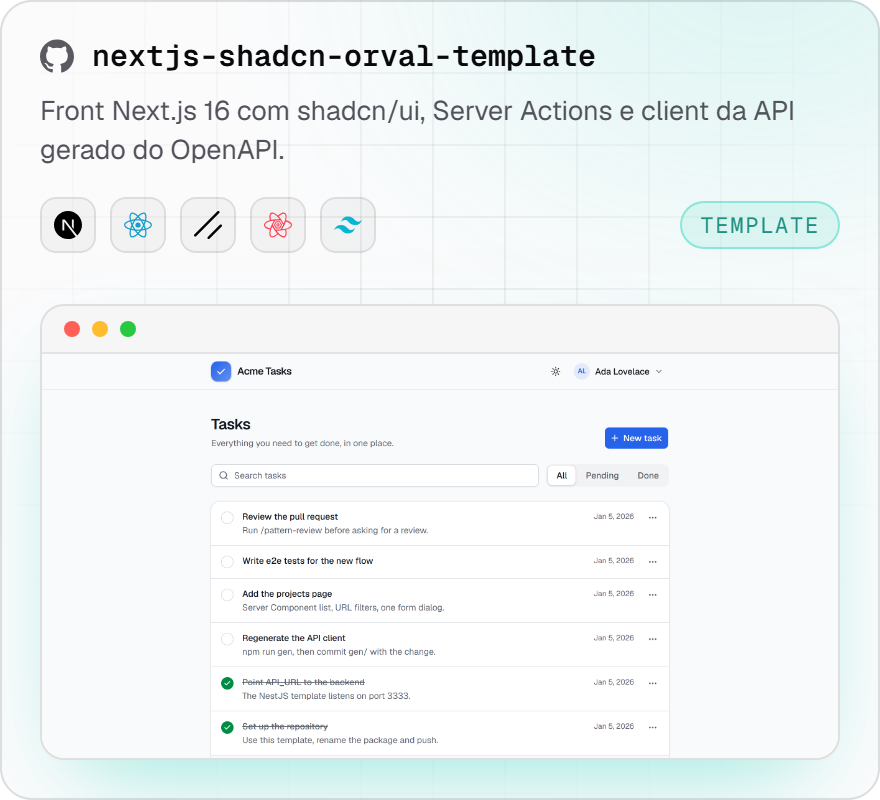</picture></a>
  <a href="https://github.com/YuriLRodrigues/nitro-hub"><picture><source media="(prefers-color-scheme: dark)" srcset="./assets/card-nitro-hub.png" />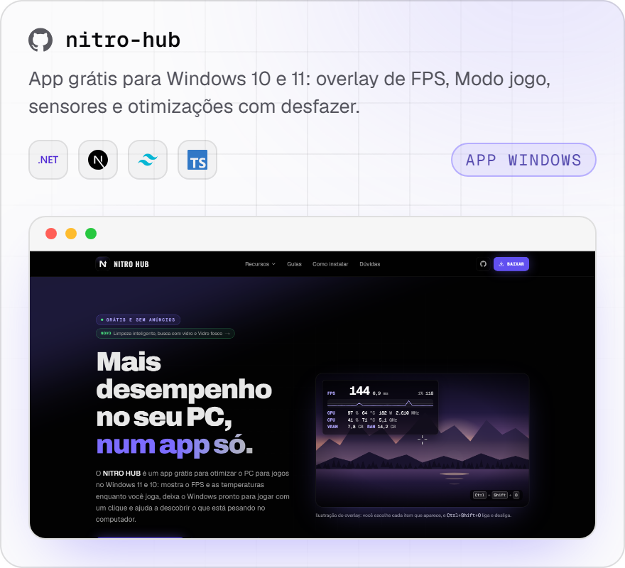</picture></a>

Os templates vêm com `CLAUDE.md` e skills do Claude Code que conhecem os padrões do projeto, e a [landing page dos templates](https://github.com/YuriLRodrigues/lp-fullstack-template) apresenta o par NestJS + Next.js. O NITRO HUB tem código fechado: o repositório guarda os instaladores, e o app se atualiza sozinho pelas [releases](https://github.com/YuriLRodrigues/nitro-hub/releases).

### Como eu trabalho

<picture><source media="(prefers-color-scheme: dark)" srcset="./assets/como-eu-trabalho.png" />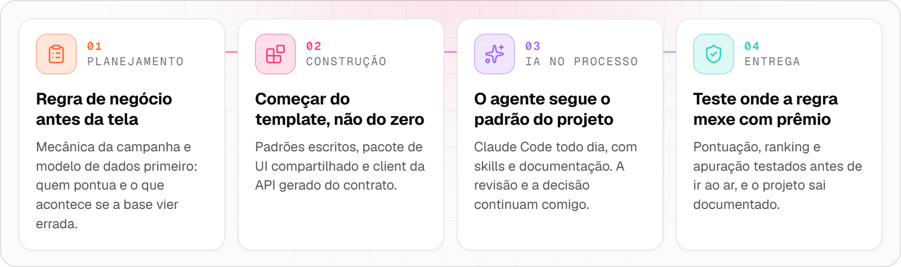</picture>

### Projetos pessoais

  <a href="https://github.com/YuriLRodrigues/workout-tracker"><picture><source media="(prefers-color-scheme: dark)" srcset="./assets/card-workout-tracker.png" />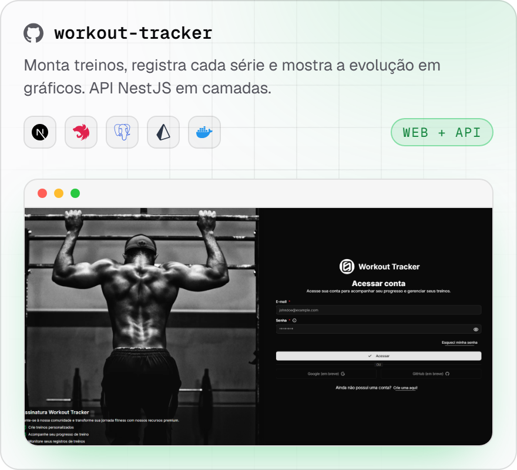</picture></a>
  <a href="https://github.com/YuriLRodrigues/autocars-frontend"><picture><source media="(prefers-color-scheme: dark)" srcset="./assets/card-autocars.png" />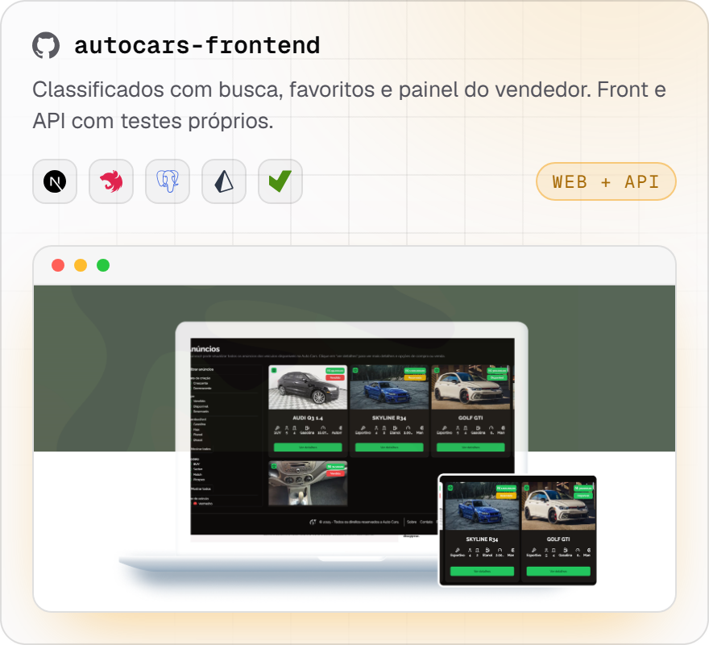</picture></a>
  <a href="https://github.com/YuriLRodrigues/fincheck"><picture><source media="(prefers-color-scheme: dark)" srcset="./assets/card-fincheck.png" />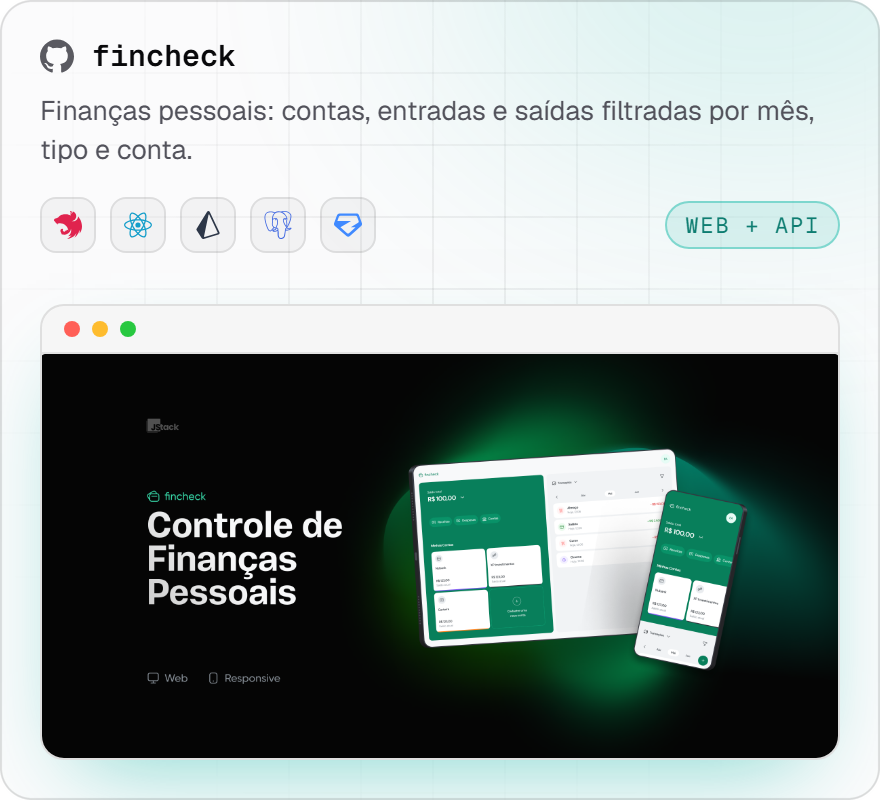</picture></a>
  <a href="https://github.com/YuriLRodrigues/setup-pro-store"><picture><source media="(prefers-color-scheme: dark)" srcset="./assets/card-setup-pro-store.png" />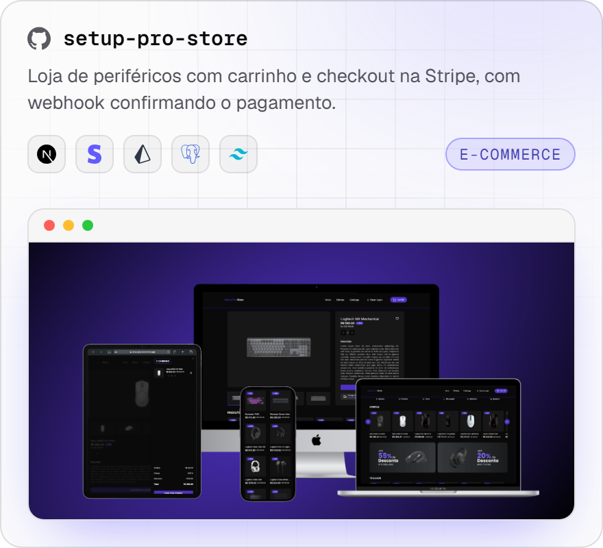</picture></a>

As APIs do Workout Tracker e do AutoCars ficam em [workout-tracker-api](https://github.com/YuriLRodrigues/workout-tracker-api) e [autocars-backend](https://github.com/YuriLRodrigues/autocars-backend).

### Stack

<picture><source media="(prefers-color-scheme: dark)" srcset="./assets/stack.png" />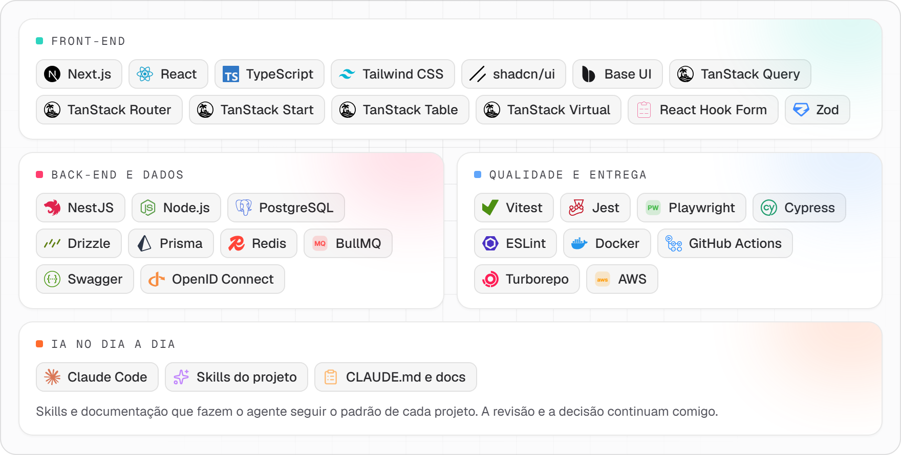</picture>

### Contribuições

<picture>
  <source media="(prefers-color-scheme: dark)" srcset="https://raw.githubusercontent.com/YuriLRodrigues/YuriLRodrigues/output/snake-dark.svg" />
  
</picture>
